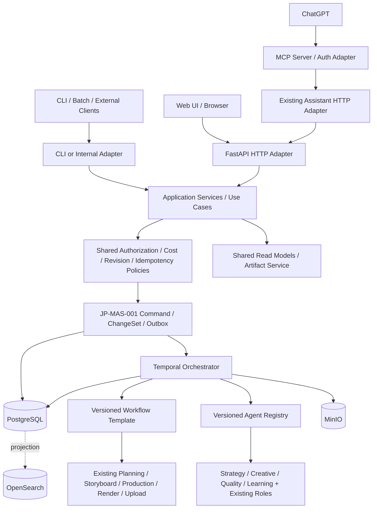

# JP-MAS-002 v1.1 — 自律改善型動画制作と拡張可能な Web UI／MCP 統合設計

- 対象：`amnysk/ai-video-platform-v2`、基準 `claude/jpmas-integration` / `94403022986ca72885ccc82aca87de93206cc02c`
- 状態：**設計案（未実装）**。v1.0からの改訂版。JP-MAS-001 v2.0 §17 初期実装は既存成果として扱う。
- 前版：`JP-MAS-002 v1.0`。改訂範囲：Application Service、Versioned Agent Registry、Versioned Workflow Template、契約単一化、共通Artifact化、変更・移行容易性の検証。
- 目的：米国20代に向けた英語の日本史・文化動画について、戦略→制作→品質評価→公開後学習を反復し、ユーザーが Web UI または ChatGPT（MCP）から安全に企画・絵コンテに参加する。
- 非目標（初期）：フル自律公開、LLMの重みの再学習、動画の成績だけによる因果断定、既存パイプラインの全面改造、任意のシーン順序・尺変更を無検証で許可すること。

## 1. 現状で再利用する実装

- `contracts/roles.py`: Producer / Writer-Director / 決定論的 Reviewer。ロール契約、許可ツール、最大呼出し回数、終了条件。
- `infrastructure/intervention/*`: AgentRun、判断履歴、改訂版、ReviewPacket、ChangeSet、認可、費用影響、outbox/冪等、hold/review checkpoint、レビュー検査。
- `apps/api/routers/intervention*.py` / `contracts/assistant_tools.py` / `apps/assistant`: 人・AIが共有する介入 HTTP API と15のツール。MCPサーバは未実装。
- `workers/pipeline/*` と `workers/intervention/*`: Temporal 実行、待機、再配送。
- `infrastructure/analytics/youtube_analytics.py` / `domain/topic_planning/analytics.py`: Analytics から7/28/90日窓で動画別成績と視聴者構成を収集、企画へ反映する既存機構（完全な公開後学習ではない）。
- `contracts/artifacts.py`: StoryboardArtifact v1.0 は scene_id=`sb1`…、連続 order・start_ms、台本との総尺・対応関係を検査。現行の ChangeKind は `script.edit_scenes` と `scene.override_visual` の2種。
- PostgreSQL を正本、MinIO を素材・snapshot、OpenSearch を再構築可能な検索投影とする。

## 2. 論理アーキテクチャと変更容易性の方針



**一本化する対象はURLではなく業務操作と不変条件**である。Web UI・MCP・CLI・内部Agentが異なる通信方式を使っても、同じユースケース・権限判定・入力検証・revision競合判定・ChangeSet・費用管理・監査記録を使う。MCP Server自身にDB・Temporal・MinIOの特権アクセスを与えない。画像アップロード、ダウンロード、非同期進捗など用途の違うAPIは分割してよい。

**段階導入**：既存 `/v1/intervention` と `infrastructure/intervention/*` は正本のまま。新規 `application/` に薄いユースケース層を追加し、既存のコマンド処理・権限・トランザクション処理を**委譲して再利用**する。最初から既存内部処理を移動して全面改造しない。

### 2.1 Hexagonal Architecture：Ports & Adapters

| レイヤー | 持つ責務 | 持たない責務 |
|---|---|---|
| Web UI / MCP / CLI adapter | 接続、表示、入力整形、プロトコル固有の認証情報交換 | 変更承認、課金判定、DB直接更新、Workflow直接起動 |
| Application Service | ユースケース調停、対象解決、共通読み取り・書き込みフロー、Policy呼び出し | UI表示、MCP固有メッセージ、provider SDKの直接利用 |
| Domain / Contracts / Policy | 型、状態、不変条件、変更影響の意味、使用可能なRole/Template/Artifact | HTTP/OAuth固有の分岐 |
| Infrastructure Adapters | DB repository、MinIO、Search、LLM/VLM/provider、Temporal gateway | 独自のユーザー承認ルール |
| Temporal Activity / Workflow | 固定された制作計画の実行、再試行、回復、Agent task dispatch | UI認証、リクエスト中の長時間LLM実行 |

依存の向きは入口→Application→Domain契約とPort、外部I/OはAdapterからPortを実装する。既存`apps/assistant`はHTTPクライアントとして維持し、公開MCP Serverも**HTTP介入APIのみ**を呼ぶ。内部のTemporal処理には、同一のdomain policy/command handlerに到達する専用Portを設けるが、権限の抜け道は作らない。

### 2.2 共通Application Serviceと操作カタログ

推奨モジュール：`application/use_cases/`、`application/ports/`、`application/policies/`（名称はコード実査後ADRで固定）。最初に必要なユースケース：

| Use case | 作用 | 主な既存実装への委譲 |
|---|---|---|
| `CreateEpisodeDraft` | Draftを作りBriefを固定する。**生成は開始しない** | 新規Episode作成の安全なPort |
| `GetEpisodeWorkspace` / `GetStoryboard` | manifest、判断、scene、asset、pendingを読み取る | `EpisodeReadModel`、ReviewPacket、artifact store |
| `ProposeStoryboardChange` | 対象版を検証しChangeSetを提案する | `receive_command(PROPOSE_CHANGE)` |
| `EstimateChangeImpact` | 再生成範囲・費用・再利用可否を返す | 既存`impact`、`budget` |
| `ApplyChange` / `ApproveReview` | 人間の認可・費用再確認・期待版確認を経て適用 | 既存intervention command/gate |
| `PauseOrResumeProduction` | hold/resume要求と状態確認 | 既存command/outbox/Temporal |
| `RegisterReferenceAsset` | staged object検証後にasset_idを確定する | MinIO asset Port + 権限/監査 |
| `GetQualityFindings` / `GetLearningReport` | 記録済み診断と実測・仮説を提供 | Artifact/measurement read model |

APIルートやMCP toolがコマンドを独自に実装することを禁止。`apply`と`propose`は別操作。読み取りは一貫性が必要な場合に正本を読み、OpenSearchだけの情報で書き込み判断を行わない。APIからの非同期操作は`202 + operation/command_id`を返し、完了確認は別リクエスト。

### 2.3 契約単一化とクライアントコード生成

**各業務操作には1つだけの正規化された入力・出力契約を持つ。** 正規スキーマの置き場所は`contracts/`内の型とする。FastAPIのrequest/responseはその型を用いOpenAPIを出力、Web UIのTypeScript型/API clientはOpenAPIから生成しCIでdriftを検知する。MCP toolsは既存`contracts/assistant_tools.py`を起点にして、**同じdomain request型から入力JSON Schemaを導出する**か明示的な薄いprojectionにする。独立して複製されたMCP専用スキーマは禁止。

- 既存15 toolの識別子と`ASSISTANT_NAMESPACE`、CommandEnvelopeの既存コマンドID方式は**変更しない**。新ツールは後方互換を維持して追加する。
- MCP公開ツールは正規カタログのallowlist。必要scope、effect（read/annotate/propose/control/apply）、入力版を公開し、`readOnly`等のヒントは実際の副作用と一致させる。
- `UserBrief`, `StoryboardPatchProposal`, `StrategyBrief`, `CreativeBrief`, `QualityReview`, `Lesson`にschema_versionを付与。旧版の読み取り・明示的アップキャストは許可するが、古いJSONの内容を黙って解釈し直さない。
- バリデーションエラー、権限不足、競合、見積変更、未見積、処理待ち、要人間承認はUIとMCPで**同じmachine-readable error code**。共通E2E/契約テストで検査する。
- `command_id`/idempotency key、`expected_control_revision`、`expected_target_revision`、`base_manifest_id`、`actor`、`correlation_id`を入口を問わず一貫して処理する。

### 2.4 変更容易性を守る境界（不変条件案）

- **INV-50（単一変更経路）**：UI/MCP/Agent/CLIは同じユースケースと介入commandの不変条件を通り、直書き・二重実装しない。
- **INV-51（定義の固定）**：RoleSpec、Workflow Template、Model Policy、Prompt、Artifact Schemaは実行単位でversion/hashを固定。稼働中Episodeへの無断差替え禁止。
- **INV-52（契約同期）**：HTTP/OpenAPI、UI生成Client、MCP tool schemaは同じ正規契約から導出し、許可scope/effectが一致する。
- **INV-53（Templateの安全性）**：未登録Agent/Tool/handler、無限ループ、権限昇格、事前未許可の有料呼出しをtemplateから起動しない。
- **INV-54（保存の互換性）**：旧Episode/Storyboard/Commandは読める。既存のrevisionと履歴・承認の意味を変更せず、変更は新revisionとして追加する。

番号は実リポジトリの`docs/invariants.md`を再確認し空きを確定した後に使う。設計上の不変条件を実装・テストと同時に採用する。

### 2.5 Versioned Agent Registry（追加・変更が容易なAgent）

現行`contracts/intervention.py::AgentRole`と`contracts/roles.py::RoleSpec`を維持したまま、登録済み役割に複数の不変`spec_version`を対応付ける`AgentRegistry`を追加する。**role名のenumは従来契約を唯一の語彙とし、Registry側で文字列を重複定義しない。**

最小AgentSpec契約：`role`, `spec_version`, `input_schema_ref`, `output_schema_ref`, `handler_ref`, `allowed_tools`, `model_policy_ref`, `prompt_version`, `max_llm_calls`, `max_tokens`, `max_estimated_cost_usd`, `timeout`, `retry_policy`, `termination`, `may_create_revisions`, `manifest_hash`。

- `handler_ref`は署名/ソース管理された**コード登録済みentrypointだけ**を指す。任意Python import文字列、外部plugin自動DL、templateからのコード実行を禁止。
- RoleSpecは責任/入出力/権限、ModelPolicyはLLM/VLM/providerの品質・費用・フォールバックを管理する。開発時Claude CodeのSonnetサブエージェント運用と、本番Agentのモデル選択を混同しない。
- Tool Gatewayが実行時の最終許可判定を行う。RoleSpecの`allowed_tools`は説明用の宣言に留めない。
- 新Roleを追加するときは新しいRoleSpec+handler+テストを登録するだけで、UI/MCPや既存Workflowのコードを変更しなくてよい構造を目指す。ただし**新種のアクションや成果物スキーマ**が必要なら契約とpolicyの拡張は必要。
- 既存RoleSpecを勝手に書き換えず、`role@spec_version`で新規実行へ展開する。旧バージョンは参照/再実行可能期間維持する。

### 2.6 Versioned Workflow Templates（制作フローの選択）

Agentの追加と**実行順序**の変更を切り離す。`WorkflowTemplate`は登録済みstage/handlerを組み合わせる**宣言的かつ制約付きのDAG定義**とし、任意コードや利用者入力からPythonを実行しない。

```yaml
# 例：設計例。実行可能な既存設定ではない
id: shorts_reviewed
version: "1.0"
format_profile: shorts_en
stages:
  - {id: strategy, handler: strategy_agent_v1, after: []}
  - {id: producer, handler: existing_producer, after: [strategy]}
  - {id: creative, handler: creative_director_v1, after: [producer]}
  - {id: script_storyboard, handler: existing_script_storyboard, after: [creative]}
  - {id: production_render, handler: existing_production_render, after: [script_storyboard]}
  - {id: qa_rules, handler: existing_reviewer, after: [production_render]}
  - {id: qa_vlm, handler: quality_reviewer_v1, after: [qa_rules]}
  - {id: private_upload, handler: existing_private_upload, after: [qa_vlm]}
post_publish:
  - {id: lesson, handler: learning_agent_v1, trigger: public_metrics_available}
limits: {max_qa_repair_cycles: 2}
```

- 利用可能なTemplate例：`daily_legacy`（**既存処理と完全同じ**）、`shorts_agentic`（自動）、`shorts_reviewed`（要レビュー）、`manual_brief`（人のテーマで開始）、`long_form_draft`（将来の拡張）。未実装Templateは起動不能として扱う。
- 配備前にschema検証、stage依存循環、handler/Agent Registry参照、必要権限、費用・timeout上限、レビューの有無、出力/入力互換、並列書込み競合を静的検査する。QA再試行はDAGへ無限辺を戻さず、明示的な上限つきsubworkflowで行う。
- Episode作成時に`template_id/version/hash`と**コンパイル済み実行計画**をRunManifest/管理ストアへ固定し、Temporalには固定計画をActivityの結果として記録させる。単に「現在のYAML」を再読込しない。動作中のtemplate編集は新versionを発行して次Episodeから適用。
- 既存`EpisodePipelineWorkflow`を直接テンプレートエンジンに書き換えない。`legacy`は既存コードパス、agenticは新しいor version-patched workflowから既存Activityを再利用。Replay/Worker Build IDやpatchingの互換性と古いhandlerの維持を検証。
- userの手動制作指示ではStrategyを省略できるが、歴史的事実を扱うEvidence検証/費用/投稿policyを省略できる設定にはしない。公開状態・予算上限をTemplateから拡張しない。

### 2.7 責任分界：Agent / Workflow / Command / UI

**Agent**=入力固定snapshotに対し提案・評価・判断記録を返す。**Workflow**=順序/再試行/待機を調停。**Command Handler**=権限/競合/費用/副作用を制御。**UI/MCP**=同じ操作をユーザーに提示する別Adapter。LearningのLessonは将来のStrategyへ入力されても、勝手にそのまま公開/採用しない。


## 3. 新規4 Agent の責任契約

| Role | 入力 | 出力 | やらないこと |
|---|---|---|---|
| `strategy` | Trend Research、Evidence候補、動画別Analytics、Lesson、ユーザーBrief、既存動画一覧 | `StrategyBrief`（対象・仮説・候補3件程度・採否・成功基準・引用・不確実性）と DecisionRecord | Producer の最終選定を勝手に上書きしない。未検証の流行・米国20代を実測と言わない |
| `creative_director` | 採用企画、Script／Storyboardの固定revision、FormatProfile、StyleGuide、視聴維持の仮説、ユーザー制約 | `CreativeBrief`、フックと演出の案、scene単位 `StoryboardPatchProposal`、DecisionRecord | 現行採用版を直接書換えない。生成器の内部仕様をDBへ漏らさない |
| `quality_reviewer` | manifest固定のScript・Storyboard・evidence・音声・完成プレビュー（代表フレーム＋タイムコード）・決定論Reviewerの結果 | `QualityReview`（所見、重大度、scene_id/time_range、根拠、確信度、推奨修正ChangeSet）、DecisionRecord | 自己評価を視聴者データとして扱わない。映像を黙って自動再生成しない |
| `learning` | 公開video_id、採用manifest、公開日時、48h/7d/28d の測定、比較可能な類似動画、過去StrategyBrief | `Lesson`（観測、仮説、代替説明、提案する実験、適用範囲、検証状態）、次回への引用可能な候補 | 非公開動画のデータ不足を低評価と断定しない。相関から因果を断定しない |

既存 `producer` はStrategyBriefを評価して動画テーマの採用を決める。既存 `writer_director` はScript/Storyboard本体を生成する。既存 `reviewer` は決定論的な整合性・manifest検査を続け、新規 `quality_reviewer` は見た目・伝達力・史実表現を追加評価する。

すべてのRoleSpecは `contracts/roles.py` の既存契約を拡張し、§2.5のVersioned Agent Registryから解決する。schema、許可ツール、費用上限、回数上限、タイムアウト、終了条件、生成できるartifact種別、モデルルーティングポリシーを`spec_version`付きで固定。Agentは許可済みTool Gateway以外のネットワーク・DB書き込みを禁止する。モデルとプロンプトバージョン、実際の使用量、DecisionRecord、ツール呼び出し参照は既存AgentRunへ保存する。欠測を0としない。

## 4. 各Agentを接続する流れ（Template選択による構成）

- **新規制作**：UserBrief（任意）→Strategy提案→Producer採用→Creative Director演出指針→既存Script/Storyboard生成→Reviewer（決定論）→生成/Render→Quality Reviewer→修正案（必要に応じて人の承認）→private upload。実行するstage/レビュー地点は§2.6のTemplateで決め、必要な安全検証はTemplateで省略不可とする。
- **日次自動制作**：従来の `legacy` を既定のまま維持。新しい `agentic` 機能はEpisode単位の明示フラグで開始し、段階的に拡大。既存Schedule・Upload可視性は変更しない。
- **投稿後の分析**：公開した動画に紐付くmanifest・公開時刻を固定し、データが揃った時点でLearningを実行。privateのままなら`awaiting_public_metrics`。Lessonは `proposed → testing → validated | rejected | retired`。validatedのみ次回Strategyの高信頼の参考として採用し、他は仮説として明示する。
- **エラー・ループ制御**：QAが問題を見つけてもデフォルトは修正案まで。承認済み予算・修正件数・試行回数内のみ自動適用可（初期は有料操作の自動承認なし）。max review loops（初期案2回）、時間・費用上限、blocked理由を記録して停止。

## 5. Web UI（`apps/web`を新設）

**技術案**：React + TypeScript（Next.jsまたはVite。既存 `apps/web` は存在しないため一方式に統一）。UIは§2.3のOpenAPIから生成した型付きClientのみで業務操作し、共通Application Service経由でFastAPIへ到達させる。UIにTemporal/DB/MinIOの特権を持たせない。

画面：

1. Dashboard：日次・手動Episode、進捗、失敗理由、予算消費、品質判定、要承認一覧。
2. New Video：テーマ、ターゲット（英語/米国20代）、形式（Shorts/long-form profile）、尺の希望、表現、BGM、キャラクター、必ず残す要素、予算希望、`private`、**サーバに登録・認可済みのWorkflow Template選択**。予算上限や公開権限をユーザー自由入力のTemplate値で上書きしない。
3. Script/Storyboard Editor：sceneカード、ナレーション、ビジュアル説明、構図、カメラ、画像プレビュー、変更案・採用版の比較、タイムコード付きコメント。drag-and-dropによる並替・尺変更は後述のv2対応まで**無効**。
4. Episode Review：ReviewPacket、QA所見、根拠・判断履歴、比較、stale、承認、停止・再開、再生成範囲と費用。
5. Learning：公開後の指標、対照動画、Lesson、仮説・試験結果。

WebSocket/SSEは進捗表示専用に使い、真の状態は読み取りAPIから再取得する（切断・再接続に強くする）。編集前のrevisionとcontrol_revisionを毎回指定し、409の場合は差分と再読込導線を出す。ブラウザからの「適用」でもMCPからの「適用」でも、§2.2の`ApplyChange`を呼び、**変更案の表示と有料承認の人間操作は別段階**とする。

## 6. 絵コンテをChatGPTから投入する契約

**目的**：このチャットから「この構図に変更」「この画像を参照」「6シーンの絵コンテを作って」と依頼できる。ただし外部LLMから現行アーティファクトを直接書き換えさせない。

### 6.1 StoryboardDraft / StoryboardPatchProposal

最初は現行 v1.0 に合わせた**既存シーンへの提案**を支持する：

```json
{
  "schema_version": "1.0",
  "episode_id": "<uuid>",
  "base_manifest_id": "<uuid>",
  "base_storyboard_revision_id": "<uuid>",
  "edits": [{
    "scene_id": "sb3",
    "visual_description": "Aerial view of a Japanese castle at dusk",
    "framing": "wide shot",
    "camera_movement": "slow push in",
    "visual_kind": "generated",
    "reference_asset_id": "<optional asset id>"
  }],
  "rationale": "Clarify the historical location visually"
}
```

これは**新しい提案専用スキーマ**の案であり、現行 `ChangeKind` が対応済みだという意味ではない。最初は映像差替えを既存 `scene.override_visual` に変換できる範囲で使い、フレーミング等を含む複数属性の変更・画像参照を扱うときは、新 `storyboard.patch_scenes` ChangeKind と契約・API・適用処理を追加する。patchの結果は新revisionで保持し、旧版を消さない。台本・絵コンテの順序/尺変更は別フェーズの`storyboard.retime_reorder`として明示設計し、台本とのカバレッジ・音声・字幕・編集の依存更新を検証するまで実装しない。

### 6.2 画像などの素材

- ブラウザUIは `POST /v1/assets/upload-intents` → 短命・対象限定のpresigned PUT URL → 完了確認/検査→ `asset_id` を使う。
- MCPは `asset_id` とメタデータを操作する。**ChatGPTでアップロードした画像をMCPが自動的に取り出せるとは仮定しない。** 添付転送に対応したクライアント機能を検証したときだけ専用経路を許可し、それまでは Web UI から素材を登録し、ChatGPTに `asset_id` を参照させる。
- ファイルのMIME/拡張子/マジックバイト、サイズ、画像寸法、SHA-256、権利情報、許可素材範囲を検査。MinIOにstaging隔離→検証後に参照可能にする。短命URL・認証情報はログやReviewPacketに保存しない。任意URLのサーバ側fetchによるSSRFを禁止。
- エピソード、素材、改訂版の所有権をサーバ側で検証。旧版素材を新しい採用版に勝手に混ぜない。

## 7. MCP Server（`apps/mcp_server`を新設）

- Python MCP SDKを利用し、**Streamable HTTP `/mcp`** をHTTPS公開。`apps/assistant`と`contracts/assistant_tools.py`のツール定義を再利用。MCP→既存介入HTTP APIという一方向のみ（DB・Temporal直結禁止）。新Toolは§2.3に従い正規ユースケース入力モデルからschema投影し、UIと別の検証実装を作らない。
- 認証はOAuth 2.1 + PKCE、resource metadata/discovery、tokenの署名/issuer/audience/expiry/scope、user/episode単位の認可、レート制限。既存の token-hash principal の内側でスコープを整合させ、ChatGPTに人用強権限 tokenを渡さない。
- 初期MCP tool：`get_episode_status`, `read_decisions`, `explain_decision`, `export_review_packet`, `compare_revisions`, `preview_change_impact`, `propose_script_edit`, `propose_scene_visual_override`, `request_hold`, `get_command_status`。既存15ツールに対して提供範囲を絞る。
- 追加ツール（新規契約＋APIが実装されてから公開）：`create_episode_draft`, `get_storyboard`, `propose_storyboard_patch`, `list_reference_assets`, `get_quality_review`, `get_learning_report`, `submit_creative_brief`。公開設定・予算上限・Scheduleを変更するツールは設けない。
- tool metadataのreadOnly/destructive/openWorldは実際の効果と一致させる。`apply_change`や有料再開は人による承認をサーバ側で必須とする。AI提案を人間の直接操作と誤記録しない。
- ChatGPT向けにオプションで **MCP Apps UI**（storyboard比較/確認パネル）を後日実装できる。まずMCP toolsを安定させる。独立Web UIと同じコンポーネントを再利用可能な範囲で設計するが、MCP UIだけに編集機能を閉じ込めない。
- 開発段階はprivate接続の検証、本番は固定HTTPSエンドポイントと監査ログ。ユーザーがChatGPT側でカスタム接続・認可する作業は必要。

## 8. 追加データとAPI（案）

**データ永続化方針（v1.1で明確化）**：Agentの増加に比例して専用テーブルを増やさない。`StrategyBrief`、`CreativeBrief`、`QualityReview`、`Lesson`の**内容と版**は、原則既存`artifact_metadata`＋MinIOのバージョン付きArtifactとして保持し、採用や依存は`artifact_manifests`・`revision_links`に記録する。検索・絞込みの性能要件が生じたら、Artifactを正本とする**再構築可能な投影/インデックス**を設ける。`agent_runs`、`decision_records`、`episode_events`を重複実装しない。

専用テーブル候補は本当にトランザクション制約・時系列クエリ・所有権・一意性が必要な`analytics_measurements`、`user_media_assets`、`asset_upload_intents`等に限定する。公開後測定は既存`analytics_snapshots`の意味・ウィンドウ・正本との重複を実査し、同じ観測を二重管理しない。`Lesson`の状態遷移・採否を要する場合も、既存annotation/commandと新revision/eventで表せるか先に評価し、専用テーブルはADRで理由と索引コストを記述した場合のみ追加する。

**Artifact契約拡張**：artifact typeとschema versionのregistryを用意し、`artifact_type@version`でvalidator/serializer/upcasterを決定する。旧`StoryboardArtifact v1.0`は現行の読み手を維持し、画像参照や複雑な構成変更が必要な場合のみ`v2`を追加する。既存保存済みJSONや旧migrationは書き換えない。モデルversion、prompt、template、AgentSpec、tool schema、成果物hashはRunManifestに結び付け、古い判断と新しい実行結果を混在させない。

追加予定API（パス・名前は実装前に契約固定）：

| API | 振る舞い | 権限 |
|---|---|---|
| `POST /v1/creative-briefs` | 人の制作依頼を保存し、企画用Draftを作成 | `draft:create` |
| `GET /v1/episodes/{id}/storyboard` | 採用版とscene、revision、プレビュー参照を返す | `read` |
| `POST /v1/episodes/{id}/storyboard/proposals` | PatchProposalを検証しChangeSet化。**適用しない** | `propose` |
| `POST /v1/assets/upload-intents` | エピソード限定のアップロード開始 | `assets:write` |
| `POST /v1/assets/{id}/finalize` | 実体検査後に素材を確定 | `assets:write` |
| `GET /v1/episodes/{id}/quality-review` | 完成品と評価・所見を取得 | `read` |
| `GET /v1/episodes/{id}/learning` | 指標とLessonを取得 | `read` |

全ての書込 API は監査イベント・相関ID・期待版・冪等キーを持つ。資産登録も重複実行防止。`proposals`は既存 `propose_change` と同じ単一コマンド/トランザクション経由で統一する。追加routeは§2.2のApplication Serviceの薄いTransport Adapterであり、**ユースケースをroute内で再実装しない**。

## 9. 学習と測定のデータ品質

- 現行 Analytics adapterの7/28/90日窓を再利用しつつ、公開後48h/7d/28dのスナップショットを別途収集。指標には測定期間と取得時刻、対象video_id・manifest_id・視聴回数・平均視聴時間・平均視聴率・登録者増減などを記録。
- 維持率を秒単位で使う場合は別の `elapsedVideoTimeRatio` クエリを追加し、映像のタイムライン上に結び付ける。API非対応・非公開・小標本は`null`/reasonとして保存。
- 年齢18–24と25–34は「米国20代」の近似に過ぎない。国と年齢が**別集計**なら同一個人の交差属性と推定しない。組合せレポートが実際に提供・許可され、十分な標本がある場合に限って利用する。
- Shortsと長尺は別ベースライン。時刻・テーマ・既存動画の大きさなど比較の偏りをLessonに記録。視聴結果を因果ではなく**仮説と検証計画**にする。

## 10. 費用・安全性・品質ゲート

1. 既存のJP-MAS-001にあるAIの有料適用禁止、dispatch gate、manifest approval、409競合、command冪等を変更しない。
2. **新規Agentの本番自動実行の前提条件**：LLMの使用量・USD/JPY換算・見積り/実績を測定し、新規workflowの呼出し回数・予算の事前予約・ハード上限を実装。既存の予算上限値があることと、全LLM/日次経路で強制済みであることは違う。
3. 新しい有料生成や再生成は原則人間の承認が必要。AIの提案だけでは課金しない。例外は明示的に事前許可された自動処理ポリシーと上限額の範囲に限り、初期はオフ。
4. Evidenceとhistorical claimsの照合、コンテンツポリシー（fal 422対策）、映像・字幕・音声の整合、著作権/肖像/出典、完成動画のprivate限定を確認する。
5. Review用フレーム抽出とVLMの推論はActivityで実行。画像・音声は制限付き参照にして、長時間実行をHTTP/MCPリクエストで同期処理しない。
6. OpenSearchにイベント、duration、モデル名、token usage、estimated/actual cost、tool名、Episode/scene/manifest/command相関を送る。失敗時もPostgreSQLの監査正本が残るようにする。

## 11. デプロイ・移行

- `JP-MAS-002`は`JP-MAS-001 v2.0`の追加設計とし、新ADR（0043以降）・追加migration（既存0018の次の未使用番号）を使う。過去のMigrationを編集しない。§2のApplication Service/Agent Registry/Workflow Template導入は**旧ルートを包む段階移行**とし、旧Dailyと既存MCP未接続Assistant CLIを並走可能にする。
- `legacy`を既定に維持し、モード・Agentをfeature flagで個別に有効化する。既存Temporal履歴とのreplay互換と既存の日次プライベート投稿を守る。
- 開発は隔離Compose・Fake LLM/fal/YouTubeで検証。初回の本番反映は新テーブルだけ先行→新workerの非稼働配備→限定Episodeで評価→段階有効化。本番へのdeployは別承認。
- DB migration rollbackはデータ消失の可能性があるため、基本は古いimageへ戻しDBは前方互換を保つ。事前バックアップと復元ドリルを必須にする。

## 12. 実装の順序・完了条件

### P0 境界確定と安全な拡張基盤
- `Application Service`のport/adapter境界とユースケース契約、`AgentRegistry`、`WorkflowTemplate`コンパイラの最小実装、Artifact Registry、OpenAPI→TS/MCP契約検査、AgentRun費用計測と予算gate、FeatureFlag、ADR/invariantsを先に設計・テスト。
- **縦断スライス**：同じ`ProposeStoryboardChange`操作をHTTP/CLI/疑似MCPから呼び、同じ検証・結果schema・費用ルールを得る。同じcommand IDと同じpayloadの安全な再送は既存ChangeSetを返す（実操作は隔離環境）。同じ`strategy` AgentSpecを新しいtemplateで参照し、旧Dailyは従来経路のままであることを示す。
- 完了：Role/Templateの未知版をreject、実行開始後の版固定、contract driftテスト、既存変更処理への委譲、権限外Tool拒否、LLM費用の欠測を0扱いしない。

### P1 Agent ワークフロー
- StrategyとCreative Directorを既存Producer/Writer前後へ接続。Quality ReviewerとLearningを非同期で接続。Lessonの利用条件を明記。選択したTemplateの各stageを登録済みAgentSpecに解決し、RunManifestへ版を固定する。
- 完了：隔離環境で1 Episodeの「戦略→private完成→品質所見」およびmock公開データの学習を再現。QA無限ループ、重複課金なし。

### P2 UIとStoryboard編集
- Episode一覧、New Video、Editor、素材アップロード、diff、approval、preview。まず既存sceneの属性編集のみ。API ClientはOpenAPIから生成し、UIで独自の業務バリデーションを正本化しない。
- 完了：UIで指定した絵コンテの変更提案→影響試算→人が承認→必要シーンだけ再生成。競合/再接続/権利・asset検査を試験。

### P3 MCP / ChatGPT
- 既存ToolSpecを束ねたread/propose MCP、OAuth、MCP Inspector、ChatGPT私用接続テスト。Operation契約と許可scopeをUI経路と一致させ、MCP固有のChangeSet生成を作らない。続いてStoryboardパッチと素材参照。任意画像のChatGPTからの直接転送はクライアント対応を確認した場合のみ追加。
- 完了：ChatGPTがEpisodeを説明し、scene修正を**提案として**登録し、Web UIで承認・採用できる。無権限／古いrevision／再送で不正変更なし。

### P4 最適化と長尺
- 比較実験の運用、Quality Reviewの信頼性評価、維持率タイムライン、長尺Profile、シーン並替/尺変更の安全実装、必要ならMCP Apps UI。

## 13. 実装テストの最小マトリクス

- 契約：RoleSpec/AgentRegistry・schema version・新ChangeKindと現行Storyboard正規化、**OpenAPI生成UI Client/MCP input schema/既存ToolSpecの整合**、旧JSONの読み取り。
- セキュリティ：OAuth無効・scope不足・他人のEpisode・不正asset ID・prompt injection・SSRF・期限切れ署名URL。
- 変更：scene ID不一致・台本版が古い・manifestが古い・重複 command ID・payload変更の再送・旧版承認の再利用拒否。
- 冪等と費用：Temporal再配送、provider応答不明、LLMトークン計量失敗、予算超過、QA無限ループ、再生成回避。**Templateの実行中差替え拒否と旧Workflow replay**。
- UX：画像アップロード、絵コンテ比較、編集競合、非同期処理、ページ再読込、private状態の表示。
- データ品質：Analytics欠測・小標本・別集計US/age・48h未達・公開時刻ずれ・遅延再取得・Lessonの版固定。
- 回帰：現行の全unit/contract/architecture/integration、Temporal replay、fal 422回復、private upload、Migration0016–0018。
- **拡張容易性**：既存コードを変更せずAgentSpecの新version登録、Templateのstage追加/省略、UI/MCP/CLIで同一ChangeSetと同一拒否理由、旧Episodeの読み取りと旧worker replay、Artifact upcast。

## 14. 参照

- 内部：`docs/design/JP-MAS-001-v2.0.md`、`docs/domain/intervention.md`、`docs/decisions/0041-*`、`0042-*`、`docs/operations/assistant.md`。
- OpenAI MCP server: https://developers.openai.com/plugins/build/mcp-server
- OpenAI MCP authorization: https://developers.openai.com/plugins/build/auth
- OpenAI MCP UI: https://developers.openai.com/plugins/build/chatgpt-ui
- YouTube Analytics dimensions: https://developers.google.com/youtube/analytics/dimensions
- YouTube Analytics queries: https://developers.google.com/youtube/analytics/reference/reports/query

## 15. v1.0 → v1.1 差分・設計決定ログ

| テーマ | v1.0 | v1.1の判断 | 主な影響 |
|---|---|---|---|
| 入口統合 | UI/MCPとも共通API | **Application Service + 共通Use Case + Policy**を明示。既存command handlerへ委譲 | 新しいクライアントを追加しても変更ルールを再実装しない |
| Agent追加 | RoleSpec追加 | **Versioned Agent Registry**、tool allowlistの実行時強制、version pin | 同じroleの複数versionを安全に併存 |
| 実行順 | 固定接続 | **Versioned Workflow Templates**、静的検証、Temporal固定実行計画 | 手動企画/Shorts/将来長尺を分離 |
| 契約 | APIとToolSpecを再利用 | **操作ごとの単一スキーマ**、OpenAPI→UI Client生成、MCP投影/ドリフト検査 | 型の二重保守をなくす |
| 保存 | 7つの新テーブル候補 | **Versioned Artifact優先**、専用テーブルは明確な理由がある場合のみ | Agentを増やしてもマイグレーションが増殖しない |
| 移行 | feature flag / legacy | **Strangler方式の段階移行**、旧Daily・旧API・旧Worker replay保持 | 稼働中の動画制作を守る |

### 15.1 変更容易性の受け入れシナリオ

1. 新しいAgent（例 `historical_fact_checker`）を追加するとき、`AgentRole`/Versioned Registry + handler + contract/testの追加で済み、既存UI・MCP・既存Templateを**変更せず**動作する。新しい画面やtoolを露出するときだけadapterを追加する。
2. `shorts_reviewed@1`へQA stageを追加する場合は`@2`を新規登録し、`@1`で開始した実行の進行/リプレイ結果は不変。
3. UIから`ProposeStoryboardChange`を呼ぶ場合とMCPから呼ぶ場合で、同じactor権限・元revision・payloadなら**同一の検証と結果型**を得る。ただし別々のcommand_idで送れば別提案になるため、同一commandを再送したときの冪等性と区別する。
4. `StoryboardArtifact v1`と`v2`を並行読込できる。v1対応workerが新規v2を書き込まないように能力を明示し、処理不可能なschemaは失敗安全側へ倒す。
5. OpenSearchが停止してもPostgreSQL正本から判断・介入・Lesson参照可能（LessonがArtifact化される場合はMinIOも必要）。検索投影は後から再構築できる。
6. 未知のtemplate、未許可のagent/tool、予算超過、競合、承認不足、staleなQAをUI/MCPのどちらからも迂回できない。

### 15.2 実装ADRで確定する未決定事項

- Agent Registry / Templateの物理配置とschema（設定ファイルとDB登録の使い分け）。**どちらでもversion/hashは必須**。
- 同時実行の上限、子Workflowの責任分界、Worker versioning方式（実際のTemporal SDK/Serverで検証）。
- モデルrouting/推論予算、UIフレームワーク、画像アップロード上限、Storyboard patchの最小属性集合、Learning測定粒度、OAuth提供元。
- `CreateEpisodeDraft`が既存Topic Plannerの日次Episode採番と競合しない一意性キー/トランザクション境界。
- Artifact Registryの旧schema upcaster、new Artifact typeのパーサ、導出投影の実装場所。

**設計上の非目標**：この改訂だけで「Agentを設定ファイルに書くだけで無検証で任意機能を実行する」仕組みにはしない。拡張点の登録には依然としてコードレビュー、契約、統合テストが必要。

